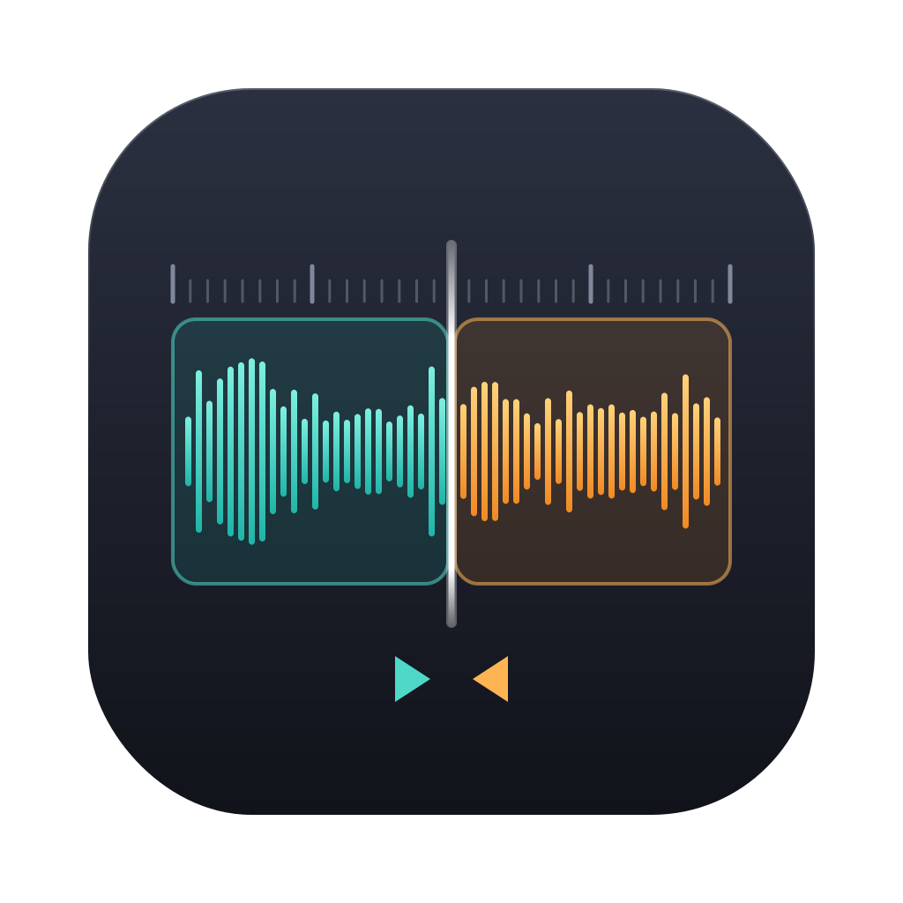

<p align="center"></p>

# WAV Joiner

A small macOS app that rejoins Broadcast WAV takes that a field recorder split mid-take.

Recorders split long takes into several files when they hit a file size limit (usually 4 GB). That breaks sync: the second file has no matching video clip, and auto-sync in Resolve or Premiere can't line it up. WAV Joiner finds those pieces by their timecode and stitches each take back into one file with the original start timecode and metadata, ready to sync.

Tested with DaVinci Resolve and Adobe Premiere Pro.

## Install

Requires macOS 11 or later on Apple silicon, or macOS 13 or later on Intel. There are two ways to get the app.

### Option 1: Build it yourself (recommended)

Building on your own Mac gives you an app macOS trusts straight away, with no security warning.

```bash
git clone https://github.com/rlschroeder/wav-joiner.git
cd wav-joiner
bash build_app.sh
```

`WAV Joiner.app` appears in the folder. Move it to Applications or your Dock. This needs Apple's Command Line Tools (which provide Swift and Python); if they're missing, the script starts Apple's installer, and you run it again when that finishes.

### Option 2: Download the pre-built app

Download `WAV-Joiner-<version>-macOS.zip` from the [latest release](https://github.com/rlschroeder/wav-joiner/releases/latest), unzip it, and move `WAV Joiner.app` to Applications.

**This app is not signed with an Apple Developer ID, so macOS will say it's from an unidentified developer and won't open it at first.** That's expected for a free open-source tool, not a sign that something is wrong. If you'd rather not deal with the warning, use Option 1 instead: an app you build yourself opens without it.

To open the downloaded app anyway:

1. Double-click **WAV Joiner**. macOS blocks it; click **Done** (or **OK**).
2. Open **System Settings → Privacy & Security** and scroll down to the Security section.
3. Next to the message about WAV Joiner, click **Open Anyway**, then confirm with your password or Touch ID.

You only need to do this once. The app runs its join engine with the Mac's built-in Python, so on a Mac without Apple's Command Line Tools, macOS will offer to install them the first time you join files. Click **Install** and try again when it finishes.

## Use

Open the app and drop folders (or WAV files) onto the window, or click **Choose Folder…**. You can also drop straight onto the app's Dock icon. Subfolders are included, and each folder is handled on its own.

## When files are joined

Files are joined only when all of these are true:

- They are in the same folder.
- Channel count, sample rate, bit depth and int/float format are identical.
- The next file's BWF start timecode (`bext` TimeReference) is exactly the previous file's start plus its length, to the sample.

Takes with gaps, a different track count or a different format are left alone. Where more than one file could follow, the join is skipped and reported rather than guessed.

## What you get, in each folder

- **`<first file>_joined.wav`** next to the originals.
  - Audio is copied byte-for-byte and never decoded, so any bit depth works (16/24/32-bit integer, 32-bit float, poly or mono) and the result is bit-identical.
  - All metadata comes from the first file of the take: `bext` (start timecode, description), `iXML` (scene, take, track names, frame rate) and any other chunks.
  - Joined files over 4 GB are written as RF64, the EBU standard for large BWF files.
- **`merged_source_files/`** holding the original pieces of each successful join. Untick the checkbox in the window to leave them in place. Files that weren't joined are never moved.
- **`wav_joiner_report_<date>_<time>.csv`** with one row per source file: output file, output start/end timecode and duration, segment (e.g. "2 of 3"), source start/end timecode, samples, channels, sample rate, bit depth, int/float, timecode rate, scene, take, where the source was moved, and notes. Skipped or failed joins and unreadable files are listed too. Timecode includes frames when the iXML gives a rate; drop-frame is shown with `;`.

Running it again on the same folder is safe: `merged_source_files/` and `_joined` files are ignored, and existing outputs are never overwritten.

## Command line

The engine is a single standard-library Python script (`wav_joiner.py`, Python 3.9+) and also works on its own, including on Windows and Linux:

```bash
python3 wav_joiner.py [--no-move] <folders or files>
```

## Tests

```bash
python3 tests/test_joiner.py
```

Builds synthetic recorder files (poly and mono, 16/24/32-bit integer and 32-bit float, iXML before and after the audio, RF64) and checks the joins are bit-identical, metadata and timecode are preserved, non-adjacent or mismatched files are left alone, sources are moved and the CSV is written.

## Project layout

```
wav_joiner.py       join engine (Python, standard library only)
app/main.swift      macOS window app that runs the engine
app/Info.plist      app bundle settings
app/AppIcon.icns    app icon (source art in icon/)
build_app.sh        builds WAV Joiner.app (universal: Apple silicon + Intel)
make_release.sh     builds and zips the app into dist/ for a GitHub Release
tests/              test suite
```

## License

[MIT](LICENSE)
